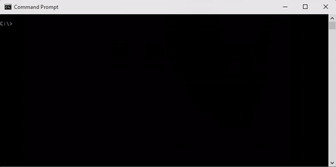

# Bob

Bob is a build tool that can help with invoking a couple of scripts, passing some sensible arguments to them.

## Installation

Bob is a [.NET tool](https://learn.microsoft.com/en-us/dotnet/core/tools/global-tools), so it can be installed globally like this:

```
dotnet tool install --global Bob.The.Builder
```

after which the `bob` command is available.

To build the package locally, run `build.cmd` – the package ends up in the `artifacts` folder, from where it can be
installed with

```
dotnet tool install --global Bob.The.Builder --add-source ./artifacts
```

## What does it do?

It has two commands: `build` and `release`.

They both call scripts in the current repository, which is assumed to be a Git repository.

On Windows, the scripts are `scripts/build.cmd` and `scripts/release.cmd` respectively.

On Linux and macOS, the scripts are `scripts/build.sh` and `scripts/release.sh` respectively. If the script has
the executable bit set, it is executed directly (respecting its shebang line) – otherwise, it is passed to `/bin/sh`.

The `release` command additionally creates an annotated Git tag for the version (using the changelog bullets as the
tag message), and pushes the tags.

Add `-v` (or `--verbose`) to see the full output from the script, e.g. `bob build -v`. Run `bob --help` to see
the available commands.

## Example



I `cd` my way to `C:\Projects-Rebus\Rebus.AutoScaling` which is where Rebus' auto-scaling plugin resides.

Then I 

```dos
C:\Projects-Rebus\Rebus.AutoScaling>bob build
```

which outputs something like this:

```dos
EXEC> C:\Projects-Rebus\Rebus.AutoScaling\scripts\build.cmd Rebus.AutoScaling 2.0.0

OK :)
```

indicating that `scripts/build.cmd` was invoked with the name of the project and a version as arguments.

The name of the project is deduced from the name of the directory, and the version is extracted from a
`CHANGELOG.md` file which is assumed to reside in the root of the repository.

The changelog is assumed to follow this format:

```
## <semver-version>

* changelog line
* changelog line

## <semver-version>

* changelog line
* changelog line
```

etc.